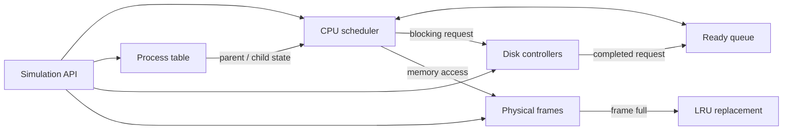

<div align="center">

# SimOS

**A deterministic operating-system simulator built in modern C++**

[](https://github.com/jasonzop/simos-project/actions/workflows/ci.yml)


SimOS models how an operating system coordinates processes, CPU time, disk I/O,
parent-child lifecycles, and paged memory—without hiding the behavior behind a UI.

[Features](#features) · [Architecture](#architecture) · [Quick start](#quick-start) · [Tests](#tests)

</div>

## Why this project?

Operating-system behavior is difficult to reason about because scheduling, blocking I/O,
process relationships, and memory replacement all affect one another. SimOS turns those
interactions into a small, inspectable state machine with deterministic results. It is useful
for experimenting with OS fundamentals and for testing lifecycle edge cases without booting a
kernel or relying on timing-sensitive threads.

## Features

- **Round-robin CPU scheduling** with a FIFO ready queue and timer interrupts
- **Process lifecycle modeling** for creation, `fork`, `wait`, zombie processes, and exit
- **Cascading termination** that releases descendant processes and their resources
- **Asynchronous disk I/O** with one active request and a FIFO queue per disk
- **Paged memory simulation** with per-process pages and global LRU frame replacement
- **Defensive API behavior** with clear exceptions for invalid disks and idle-CPU operations
- **Portable automation** through CMake and CI on Linux, macOS, and Windows

## Architecture



| Subsystem | Model | Key behavior |
| --- | --- | --- |
| CPU | One running PID plus a ready queue | Timer interrupts rotate processes in FIFO order |
| Processes | Parent-child tree | `wait` blocks; exited children become zombies until collected |
| Disk I/O | Independent queue per disk | A request blocks its process until completion |
| Memory | Fixed-size physical frames | Pages are loaded on access; the least-recently-used page is evicted |

The simulator maintains explicit invariants between these subsystems. For example, a process
blocked on disk cannot also be on the ready queue, and a cascading exit removes every descendant
from the CPU, queues, disks, and memory. See [the architecture notes](docs/ARCHITECTURE.md) for the
state transitions and design tradeoffs.

## Quick start

### Prerequisites

- A C++17 compiler (GCC, Clang, or MSVC)
- CMake 3.20 or newer

### Build and run

```bash
cmake -S . -B build -DCMAKE_BUILD_TYPE=Release
cmake --build build --config Release
./build/simos_demo
```

On Windows with a multi-configuration generator, the executable is usually at
`build/Release/simos_demo.exe`.

Expected output:

```text
Running process: PID 1
Disk 0 request: config.json
Resident pages: 2
```

## Example

```cpp
#include "SimOS.h"

SimOS os(/* disks */ 2, /* RAM */ 4096, /* page size */ 64);

os.NewProcess();                   // PID 1 starts running.
os.SimFork();                      // PID 2 joins the ready queue.
os.TimerInterrupt();               // PID 2 receives the CPU.
os.DiskReadRequest(0, "data.db"); // PID 2 blocks; PID 1 resumes.
os.AccessMemoryAddress(0x1000);    // PID 1's page is loaded into a frame.
os.DiskJobCompleted(0);            // PID 2 becomes ready again.
```

The public inspection methods—`GetCPU`, `GetReadyQueue`, `GetDisk`, `GetDiskQueue`, and
`GetMemory`—make every state transition observable and straightforward to test.

## Tests

The dependency-free test suite covers:

- constructor and API validation;
- round-robin scheduling order;
- disk blocking, queueing, and completion;
- least-recently-used page replacement;
- parent/child wait and exit synchronization; and
- cascading cleanup of disk and memory resources.

Run it locally with:

```bash
cmake -S . -B build -DBUILD_TESTING=ON
cmake --build build --config Release
ctest --test-dir build --build-config Release --output-on-failure
```

Every pull request runs the same build and tests on Ubuntu, macOS, and Windows.

## Project structure

```text
.
├── .github/workflows/ci.yml  # Cross-platform continuous integration
├── docs/ARCHITECTURE.md      # State model and design decisions
├── examples/demo.cpp         # Minimal runnable example
├── include/SimOS.h           # Public API and data model
├── src/SimOS.cpp             # Simulator implementation
├── tests/simos_tests.cpp     # Dependency-free regression suite
├── CMakeLists.txt            # Portable build configuration
└── CONTRIBUTING.md           # Development workflow
```

## Roadmap

- Configurable scheduling strategies (priority and shortest-job-first)
- Dirty-page tracking and write-back behavior
- Process metrics such as turnaround and wait time
- Event traces that can be exported for visualization

## Contributing

Bug reports and focused improvements are welcome. Read [CONTRIBUTING.md](CONTRIBUTING.md) for
the build, testing, and pull-request workflow.
