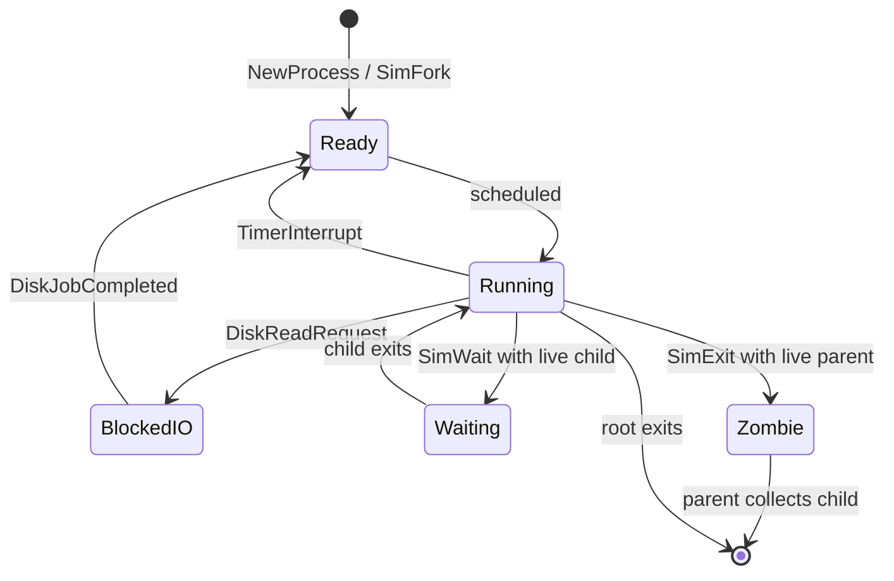

# SimOS architecture

SimOS is an in-memory, deterministic state machine. Each public command represents an operating
system event; no background threads or wall-clock timing are involved. This keeps transitions
repeatable and makes the simulator suitable for unit tests and classroom experiments.

## State model

The simulator owns four connected state stores:

1. **CPU** — either `NO_PROCESS` or the PID of exactly one running process.
2. **Ready queue** — runnable PIDs waiting for CPU time in FIFO order.
3. **Process table** — lifecycle metadata, parent-child links, and wait/zombie state.
4. **Resources** — disk request queues and physical memory frames owned by PIDs.

## Process transitions



The first process is dispatched immediately when the CPU is idle. Later processes join the back
of the ready queue. A timer interrupt moves the running PID to that same queue before dispatching
the next PID.

## Disk model

Each disk has one active request and a FIFO queue. Issuing a read request blocks the running
process. Completing a request makes its owner runnable, promotes the next request, and dispatches
a process if the CPU is idle.

Disk indexes are checked at the API boundary. Invalid indexes throw `std::out_of_range` instead of
silently corrupting simulator state.

## Memory model

Memory is divided into `amountOfRAM / pageSize` physical frames. A virtual address maps to a page
with integer division:

```text
page number = virtual address / page size
```

On a page hit, the frame's logical access time is refreshed. On a miss, SimOS uses the first free
frame; when all frames are occupied, it replaces the frame with the oldest access time. Page
identity includes both PID and page number, so identical virtual addresses in different processes
remain isolated.

## Cleanup invariants

Process termination is deliberately centralized. Removing a process also removes it from:

- the CPU, if currently running;
- the ready queue;
- active and queued disk requests;
- every physical memory frame; and
- its parent's child list.

When a process exits, its descendants are terminated recursively. This prevents orphaned work or
stale resource ownership from surviving a cascading exit.

## Complexity

| Operation | Time complexity | Reason |
| --- | --- | --- |
| Schedule next process | O(1) | Deque front/pop |
| Create or fork process | Average O(1) | Hash-table insert plus queue append |
| Submit/complete disk request | O(1) | One deque per disk |
| Access resident page | O(F) | Scan of `F` physical frames |
| Terminate process | O(R + DQ + F) | Cleanup across ready, disk, and frame state |

The linear memory scan is intentional: it keeps the replacement policy easy to inspect. A future
version could add indexes for larger simulations while preserving the same public behavior.
